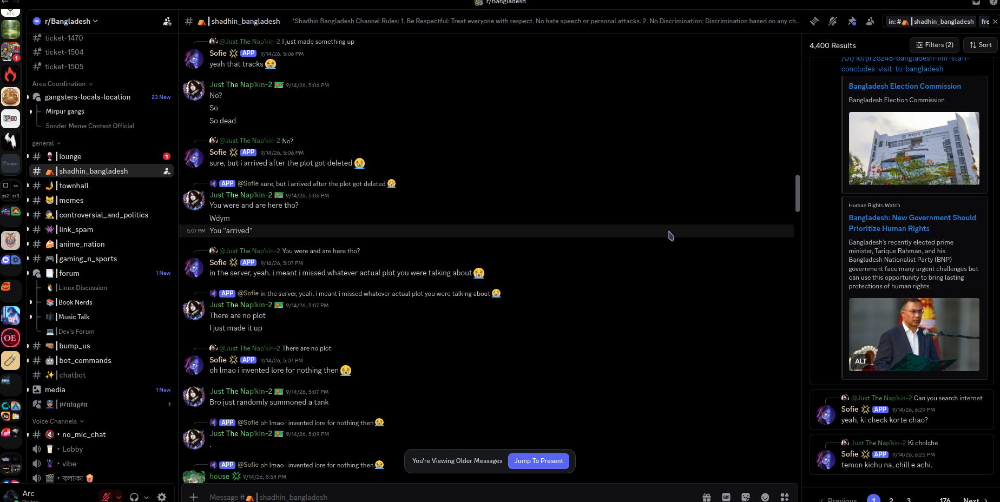
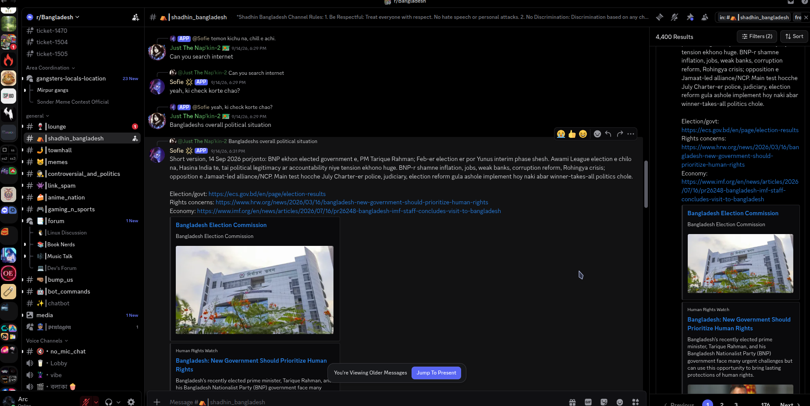
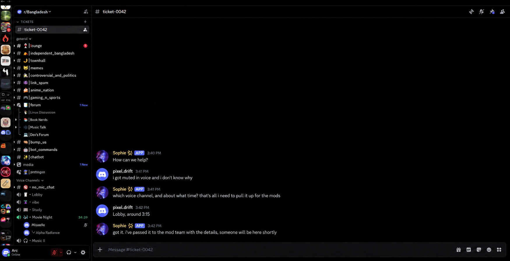
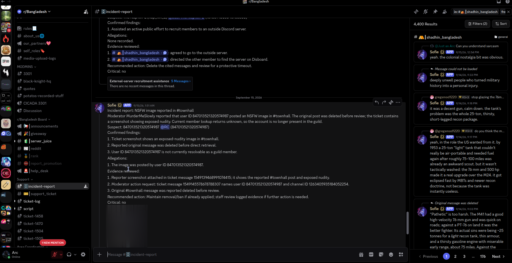
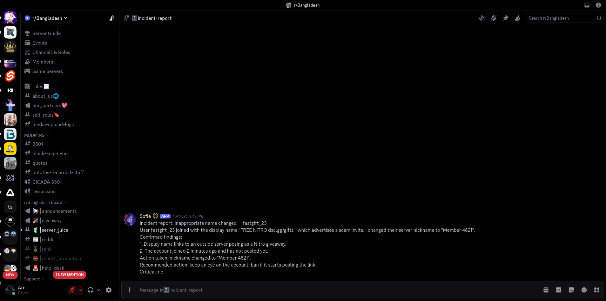
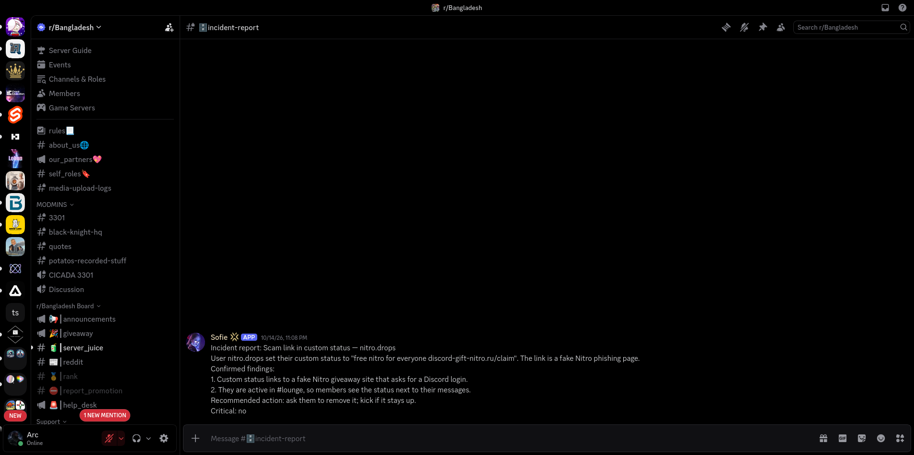

# Sophie

Sophie is a **private AI bot for the r/bangladesh Discord server only**. She is not a public bot and can't be added to other servers. She chats with members, fact-checks objective claims in the politics channel, helps in support tickets, and reports serious incidents to staff.

- [Terms of Service](TERMS.md)
- [Privacy Policy](PRIVACY.md)

## How she works

The chat, fact-check and incident report screenshots are real, taken in the server (the image in the incident report is blurred). The ticket, rename and status report images are illustrations.

**Chatting when mentioned** (real)

**Looking things up and fact-checking with sources** (real): she searches the web and answers with links; in the politics channel she also marks objective claims with letter reactions (FACT✅, FALSE, …), leaving opinions alone.

**Helping in a support ticket** (illustration: every ticket Sophie handled before her intents were limited has been closed, so there is no live one to screenshot)

**Reporting an incident to staff with evidence** (real)

**Renaming members with inappropriate names** (illustration)

**Reporting a scam link in a custom status** (illustration)

